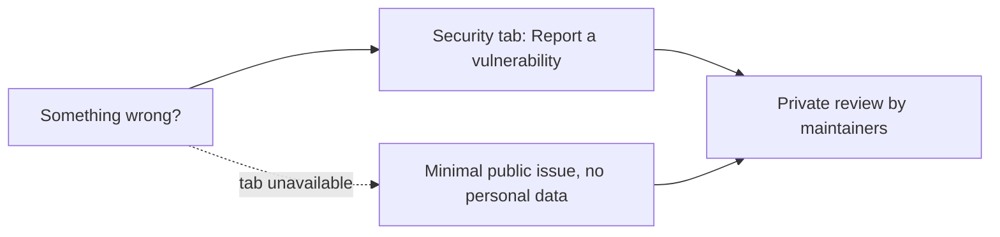
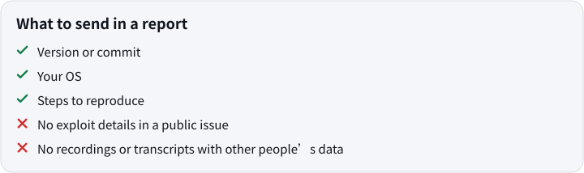

# Security Policy

Report privately first; there is no bug bounty and no guaranteed response time.

Scope: the code in this repository; third-party models and libraries go to their upstream projects.

Full text

tinglongWu is a research project maintained on a best-effort basis. There is no bug bounty and no guaranteed response time.

## Reporting a vulnerability
- Preferred: use GitHub private vulnerability reporting (repository "Security" tab -> "Report a vulnerability").
- If that is unavailable, open a GitHub issue with a minimal description and no exploit details or personal data; the maintainer can then move the discussion to a private channel.

Please include the version or commit, your OS, and steps to reproduce. Do not attach recordings or transcripts that contain other people's data.

## Scope
The code in this repository (including the network guard and the model downloader). Vulnerabilities in third-party models, libraries or drivers should be reported to their upstream projects. The network guard is best-effort, not a guarantee.

