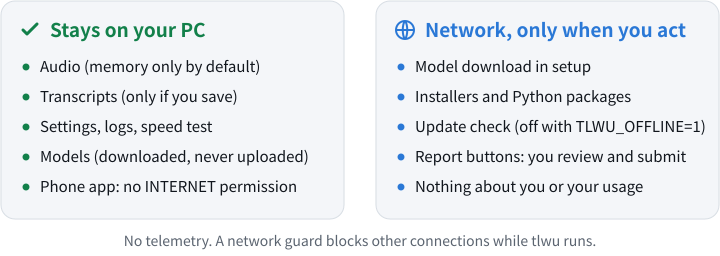

# Privacy statement

[繁體中文](PRIVACY.zh-TW.md)

Your voice and text never leave your PC; the network is used only for the steps you start yourself.

Full text

tinglongWu translates speech on your own computer. This page says what stays local and every case where the network is used. It describes the code in this repository; it is not a legal guarantee (see "Limits").

## What stays on your machine
- **Audio and text are processed locally and are not uploaded.** Audio lives in memory only by default; only if you opt in to `--record` is it saved on this computer (`transcripts/rec-*/`).
- **Transcripts are not saved by default.** Only the opt-in `--save` (GUI: the save checkbox) and `--save-result PATH` (speak mode) write text to disk, as local files (`transcripts/`, JSONL).
- **Local files tlwu writes:** `gui.json` (your settings), the user config file `config` in your config folder (`auto_update`, `update_last_check`, `ui_lang`), run logs and `install.log` (installer self-test) in your log folder, `speedprobe.json` (speed-test result), `netguard.jsonl` (see below), a temp file holding only a language code, and the opt-in transcripts above.
- **Models** are stored in the `models/` folder of the install (or `TLWU_MODELS` / `--models-dir`); they are only downloaded, never uploaded.
- **No telemetry.** None was found in the 2026-11 audit. On import, tlwu also sets `HF_HUB_OFFLINE`, `TRANSFORMERS_OFFLINE`, `HF_HUB_DISABLE_TELEMETRY`, `DO_NOT_TRACK` and similar variables.

## Every network access
The runtime package `tinglongwu/` contains no network code; a Python-level network guard also blocks non-loopback connections while tlwu runs. Network-capable code lives in `tinglongwu_setup/` and the install/update scripts:

| # | What | When | What is sent | How to turn it off |
|---|------|------|--------------|--------------------|
| 1 | Model download by `tlwu-setup`: Hugging Face (Whisper, Hy-MT2 GGUF; pinned commit + SHA256), Argos OPUS index on `raw.githubusercontent.com` and archives from argos-net.com (only `ru-en` and `en-zh` are pinned; other pairs are not) | Only when you run setup and answer yes | Ordinary HTTPS requests (your IP, user agent, the requested file) | Do not run setup / answer N |
| 2 | Kokoro TTS model download in `scripts/mac_install.sh` (third-party GitHub release; size + SHA256 checked, a mismatch deletes the file and aborts). Vosk Russian TTS model: manual download from alphacephei.com, no hash | macOS install / manual | Ordinary HTTPS requests | Skip the step |
| 3 | Python dependencies: PyPI, plus a third-party index for the llama-cpp wheel (`requirements-llama-cuda.txt`) | `install.ps1`, `tlwu-setup --deps`, `mac_install.sh`, auto-update when requirements change | Ordinary HTTPS requests | Do not run the installers |
| 4 | Opt-in auto-update: `git fetch` of the `main` branch on GitHub (6 s cap); may run `pip install -e .` if requirements changed | Asked once, default off | Git protocol requests | Answer no, or set `TLWU_NO_UPDATE=1` |
| 4b | Windows setup-wizard update check (`tinglongwu_setup/selfupdate.py`, run as a child of the GUI): GitHub API `releases/latest` (6 s cap), then, only when there is a newer version, the release's `SHA256SUMS.txt` and `tinglongwu-setup.exe` from GitHub (SHA256-checked before it runs) | Once a day at GUI start if *Update automatically* is ticked in setup (stored as `auto_update=1`); the wizard pre-selects it (`release/installer/tinglongwu.iss`, task `autoupdate`, not `unchecked`), so untick it if you do not want it; otherwise only when you click **Check for updates** | Ordinary HTTPS requests (your IP, user agent); nothing about you or your usage | Untick *Update automatically* (setup or ⚙ Adjust), or set `TLWU_OFFLINE=1` (no request at all) |
| 4d | Update counter (`COUNTER_BASE` in `tinglongwu_setup/selfupdate.py`): the update check of row 4b may first ask the counter Worker's `/v1/latest` URL on its own host (4 s cap), then falls back to GitHub | Same as 4b. **Off until `COUNTER_BASE` is set; it is empty today, so nothing is sent.** | The date (as seen by the Worker), the app version and the OS (`windows` / `mac` / `linux`); no install ID, no account, no transcript | Same as 4b (`TLWU_OFFLINE=1` sends nothing) |
| 4c | Windows GPU pack download (`tlwu-setup --gpu-pack`, `tinglongwu_setup/gpu_pack.py`): the release's `tinglongwu-gpu-pack.zip` (cuBLAS / cuDNN DLLs) and its `.manifest.json` from GitHub Releases (size + SHA256 checked before unpacking). Vulkan pack (`tlwu-setup --vulkan-pack`, `tinglongwu_setup/vulkan_pack.py`): the release's `tlwu-vulkan-pack-<version>.zip` (Linux: `tlwu-vulkan-pack-linux-<version>.zip`), checked against the release's `SHA256SUMS.txt` before unpacking | Only when you run `tlwu-setup --gpu-pack` / `--vulkan-pack` or the GPU step in setup | Ordinary HTTPS requests (your IP, user agent, the requested file) | Do not run them; the CPU path keeps working |
| 5 | Installers fetching the source: Windows setup wizard `tinglongwu-setup.exe` (bundles the source; `install.ps1` then downloads Python 3.12 from python.org if missing, SHA256-checked, and the Python packages); Windows `scripts/bootstrap_windows.ps1` (git clone from GitHub, or the GitHub zip of the tag when git is missing); Linux `scripts/install.sh` (`curl \| bash` from the GitHub release, then git clone); macOS `mac_install.sh` (`curl \| bash` from the GitHub release, git clone, Homebrew) | When you run it | Ordinary HTTPS requests | Do not run it |
| 6 | Network-guard report (`tinglongwu/netreport.py`): opens your browser on a pre-filled GitHub issue | Only if a connection was blocked and you answer y; the exact text is shown first and you submit it yourself | Version, commit, OS string, host/port/package/mode/count, up to 12 `module:function:line` stack frames. No transcript, username, home path or hostname | Answer N |
| 6b | Report a problem (GUI button / `tlwu --report`, `tinglongwu/report.py`): opens your browser on a pre-filled GitHub issue | Only when you click it; you review the text on GitHub and submit it yourself | App version, OS, Python, CPU model/AVX, cores, RAM, GPU/VRAM, NVIDIA driver, package versions, current settings (GUI) or language pair/engine (CLI), the last install self-test block, up to the last 200 run-log lines (cut to fit the URL); home path and user name are redacted | Do not click it |
| 7 | Mobile: one-tap download of optional voice/language packs from this repo's GitHub release assets (INTERNET is used for nothing else) | Only when you tap a download button | The request for the pack file (your IP address is visible to GitHub); no ID, no audio, no text | Import the zip by hand instead |
| 8 | Developer-only scripts (`scripts/bench/*`, `scripts/make_lock.py`), not shipped | - | - | - |

`TLWU_ALLOW_NET=1` disables the network guard; do not set it unless you need to.

`netguard.jsonl` (in your user log directory) records blocked attempts: time, host, port, package, trimmed stack. It has no PII and is never sent automatically.

## Android app (tinglongWu mobile / TingLong on Google Play)
- **說話翻譯 (speech translation): audio is processed on the phone only.** The microphone hears the people around you; speech recognition and translation run on the device; audio and text are never uploaded, and audio is kept in memory only. Nothing is recorded.
- **看影片翻譯 (video translation, Android 10+):** captures the audio other apps are playing, and only after you agree in the system dialog each time. The audio is processed in the phone's memory only; it is never recorded, saved or uploaded. Apps that disallow capture (for example copyright-protected video, calls) give silence. The floating subtitle window needs the "Display over other apps" (顯示在其他應用程式上層) permission.
- **Network only for pack downloads.** Translation, speech recognition and speech output run offline. The app uses Android's INTERNET permission only for pack downloads you tap, from this repo's release assets; it sends no audio, text or ID.
- **Models:** either you download the model pack with your browser and import it with the system file picker, or, for the Google Play version, the Play Store downloads them as Play Asset Delivery packs. Either way every file is checked (size + SHA-256) and stored in the app's own folder on the phone.
- **Subtitle history:** subtitle history is stored only on the device, can be turned off, and is auto-deleted after 30 days. It holds the finalized subtitle lines (original and translation) of each session in the app's private storage, never audio; it is not uploaded, shared, exported or backed up. In the app: subtitle settings > 保存字幕紀錄 (switch), 字幕紀錄 (list, delete one session), 刪除全部紀錄 (delete all).
- **Stored on the phone:** the model files, the subtitle history above, and a local run log in the app's folder. No account, no analytics, no ads, no advertising ID.
- **No data is collected or shared** with the developer or third parties. Google Play itself handles installs, updates and the pack download under Google's own privacy policy.
- **Delete everything:** uninstall the app (Android removes its folder and the models), or delete only the subtitle history in the app (刪除全部紀錄).

## Payment
Paid versions: checkout (email, license key, card data) is handled entirely by the payment provider. tlwu does not store payment data.

## Limits
- The network guard blocks Python-level sockets only. Native libraries (ctranslate2, onnxruntime, llama.cpp) and other subprocesses are not covered; an OS firewall test is the independent check (see README, "Privacy model").
- Some downloads are not yet hash-pinned (row 1: Argos pairs other than `ru-en` / `en-zh`; row 2: the Vosk Russian model).
- Your OS may write crash dumps or a pagefile that can contain memory contents; tlwu cannot control this.

## Contact
Privacy questions: open an issue at https://github.com/sunososobro-hub/tinglongwu/issues, or report sensitive matters privately as described in [SECURITY.md](SECURITY.md).

