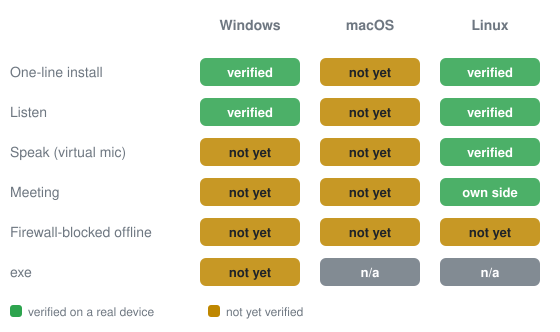
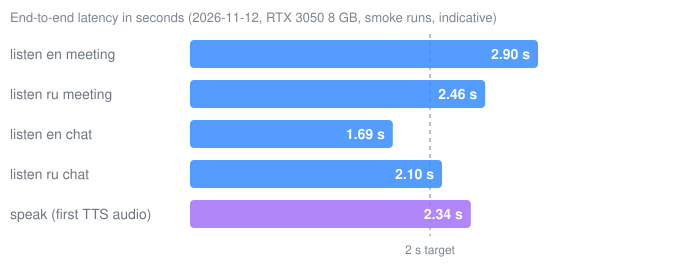
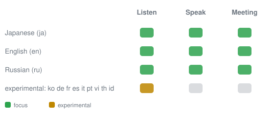

# tinglongWu

Offline real-time speech translation for meetings and calls.

English | [繁體中文](README.zh-TW.md) | [简体中文](README.zh-CN.md)

| OS | Install (latest release) |
|---|---|
| Windows 64-bit | Download [tinglongwu-win64.zip](https://github.com/sunososobro-hub/tinglongwu/releases/latest/download/tinglongwu-win64.zip), extract it, double-click `tlwu.exe` |
| Linux (x86_64, Ubuntu 24.04 tested) | `curl -fsSL https://github.com/sunososobro-hub/tinglongwu/releases/latest/download/install.sh \| bash` |
| macOS | `curl -fsSL https://github.com/sunososobro-hub/tinglongwu/releases/latest/download/mac_install.sh \| bash` |

First time? See [what you might see during install](#what-you-might-see-during-install) (unsigned-app warnings are expected).

<!-- TODO: screenshot or GIF of the subtitle window (docs/img/demo.gif); no screenshot exists in the repo yet. -->

### What you might see during install

tinglongWu is a small open-source project and does not pay for a Windows code-signing certificate or an Apple Developer account, so a few warnings are normal. Every release lists SHA256 checksums of all its files in `SHA256SUMS.txt` if you want to verify a download.

- **Windows:** `tlwu.exe` is not code-signed (see [docs/install.md](docs/install.md#releases-read-before-trusting-a-binary)). Extract the whole zip first (do not run it from inside the zip). On first start Microsoft SmartScreen may show "Windows protected your PC": click **More info**, then **Run anyway**. Some antivirus tools may also flag unsigned builds. If `tlwu.exe` does not open at all (no window, or a missing-DLL error), install the Microsoft Visual C++ Redistributable 2015-2022 (x64). On first run the app shows which models it will download and how big they are (about 1 GB on CPU, more with an NVIDIA GPU) and asks before downloading.
- **macOS:** there is no app to double-click, so there is no "unidentified developer" prompt for tinglongWu itself. The installer's messages are in Traditional Chinese. It needs Homebrew first: if it is missing, the script stops and prints the official install command (https://brew.sh); follow its "Next steps", open a new Terminal window, and run the command again. Homebrew then installs Python 3.12, git and the BlackHole 2ch/16ch audio drivers; the driver install asks for your Mac password (typing shows nothing). If a BlackHole install fails (wrong password or blocked by security settings), just run the command again. A restart may be needed before BlackHole shows up. One manual step remains, printed at the end: in Audio MIDI Setup create a Multi-Output Device (your speakers/headphones + BlackHole 2ch) and use it as the sound output; in Meet/Zoom pick **BlackHole 16ch** as the microphone. On first run macOS asks to let Terminal use the microphone: click OK (or enable it later in System Settings > Privacy & Security > Microphone).
- **Linux:** run it as your normal user, not root. It needs Python 3.12 (Ubuntu 24.04's default). Before any `apt` step it lists the missing packages and asks y/N; yes asks for your sudo password. It downloads the Kokoro English voice (about 120 MB); speech/translation models are only downloaded later, after the menu asks.

## Verification status

## Docs

**[Docs (install options, requirements, privacy, FAQ, all guides)](https://sunososobro-hub.github.io/tinglongwu/docs.html)** · [docs/details.md](docs/details.md)

## Contributors

Contributions of any kind welcome — bug reports count too.

<!-- ALL-CONTRIBUTORS-LIST:START - Do not remove or modify this section -->
<!-- prettier-ignore-start -->
<!-- markdownlint-disable -->
<table>
  <tbody>
    <tr>
      <td align="center" valign="top" width="14.28%"><a href="https://github.com/sunososobro-hub"> <b>sunososobro-hub</b></a> <a href="https://github.com/sunososobro-hub/tinglongwu/commits?author=sunososobro-hub" title="Code">💻</a> <a href="https://github.com/sunososobro-hub/tinglongwu/commits?author=sunososobro-hub" title="Documentation">📖</a> <a href="#maintenance-sunososobro-hub" title="Maintenance">🚧</a></td>
      <td align="center" valign="top" width="14.28%"><a href="https://github.com/cook1e0728"> <b>cook1e0728</b></a> <a href="https://github.com/sunososobro-hub/tinglongwu/commits?author=cook1e0728" title="Code">💻</a></td>
      <td align="center" valign="top" width="14.28%"><a href="https://github.com/psgo555"> <b>psgo555</b></a> <a href="https://github.com/sunososobro-hub/tinglongwu/issues?q=author%3Apsgo555" title="Bug reports">🐛</a></td>
      <td align="center" valign="top" width="14.28%"><a href="https://github.com/jchodev"> <b>jchodev</b></a> <a href="https://github.com/sunososobro-hub/tinglongwu/commits?author=jchodev" title="Code">💻</a> <a href="#ideas-jchodev" title="Ideas, Planning, & Feedback">🤔</a></td>
    </tr>
  </tbody>
</table>

<!-- markdownlint-restore -->
<!-- prettier-ignore-end -->

<!-- ALL-CONTRIBUTORS-LIST:END -->

MIT License. See [LICENSE](LICENSE). (c) 2026 Alonso.
