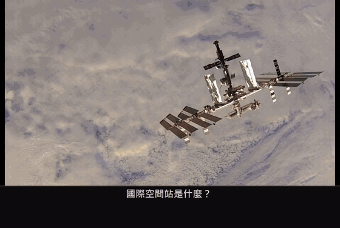
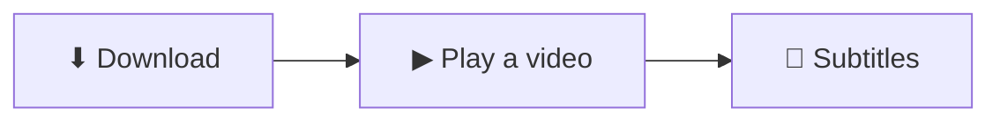
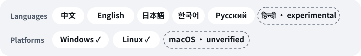
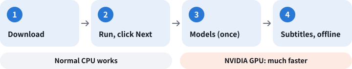

English | [繁體中文](docs/README.zh-TW.md) | [简体中文](docs/README.zh-CN.md)

# tinglongWu 聽龍

 77 MB + 1.6 GB models · SmartScreen: More info → Run anyway

More: install, privacy, FAQ, contribute

   

## Download

| | Install |
|---|---|
| **Windows 10/11** | **[⬇ Download tinglongwu-setup.exe](https://github.com/sunososobro-hub/tinglongwu/releases/latest/download/tinglongwu-setup.exe)**, run it, keep clicking **Next** |
| macOS | `curl -fsSL https://github.com/sunososobro-hub/tinglongwu/releases/latest/download/mac_install.sh \| bash` |
| Linux (x86_64) | `curl -fsSL https://github.com/sunososobro-hub/tinglongwu/releases/latest/download/install.sh \| bash` |

SmartScreen warns because the installer is unsigned until #601 lands; Edge hides Keep: hover the download → **…** → **Keep** → open the ▾ next to **Delete** → **Keep anyway**; then click **More info → Run anyway**. Prefer to inspect first? Download `mac_install.sh` / `install.sh` from the [release](https://github.com/sunososobro-hub/tinglongwu/releases/latest), read it, compare it with `SHA256SUMS.txt` on that page, then run it.

**Update (Windows):** if you kept *Update automatically* ticked in setup, the app checks GitHub once a day, downloads the new version and asks **Restart now?**; any time: ⚙ Adjust → **Check for updates**. Models and settings are kept. Remove on macOS/Linux: `bash ~/tinglongwu/scripts/uninstall.sh` (models stay unless you add `--purge`).

Setup downloads speech and translation models once; optional packs (extra languages, speak mode, GPU) also need internet once. After that translation, audio and subtitles never use the network. Auto-update (default on in the Windows installer; the `git` update in PRIVACY.md is off by default) sends no ID; untick it in setup or set `TLWU_OFFLINE=1` for zero network requests.

## Languages and requirements

[More languages coming](docs/VISION.md). [Full docs (FAQ, privacy)](https://sunososobro-hub.github.io/tinglongwu/docs.html) · [Platforms](docs/support.md) · [Language pairs](docs/languages.md) · [Report with AI](docs/report-with-ai.md) · [Glossary with AI](docs/glossary-with-ai.md)

## Want to help?

- 📘 [How to contribute](.github/CONTRIBUTING.md): PRs are welcome, the default answer is yes
- 🟢 [Good first issues](https://github.com/sunososobro-hub/tinglongwu/labels/good%20first%20issue)
- 💬 [Discussions](https://github.com/sunososobro-hub/tinglongwu/discussions): ask, show your setup, share an idea (no GitHub skills needed)
- 🧭 [Vision: what we build and what we never do](docs/VISION.md)
- 🗺️ [Roadmap](https://sunososobro-hub.github.io/tinglongwu/roadmap.html) · 📍 [Next release progress](https://github.com/sunososobro-hub/tinglongwu/milestones) · 📊 [Project activity](https://sunososobro-hub.github.io/tinglongwu/)

<!-- CONTRIBUTORS:START -->
<b>Built with help from 5 people</b>

    

AI helpers: 🤖 <a href="https://www.anthropic.com/claude">Claude</a> (Anthropic) · 🤖 <a href="https://www.coderabbit.ai">CodeRabbit</a> (code review) 💻 code · 🐛 bug report · 📖 docs · 🤔 ideas · 🚧 maintenance · 🤖 AI tool (not counted as people)
<!-- CONTRIBUTORS:END -->

MIT License. See [LICENSE](LICENSE). [Code signing policy](docs/CODE_SIGNING_POLICY.md) (SignPath Foundation). (c) 2026 Alonso.

 聽龍 / TingLong, the listening dragon

