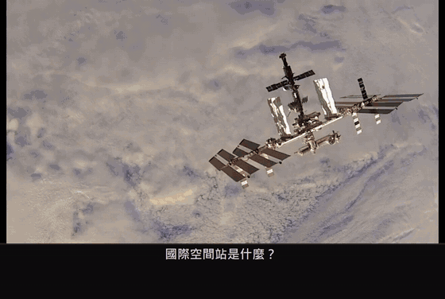

[English](README.md) | [繁體中文](README.zh-TW.md) | 简体中文

# tinglongWu 听龙

| 🎧 听 | 🗣️ 说 | 🔁 双向 |
|:-:|:-:|:-:|
| 实时字幕 | 语音输出 | 双方互译 |

  <b><a href="https://github.com/sunososobro-hub/tinglongwu/releases/latest">⬇ 下载 Windows 版</a></b>

更多：安装、隐私、常见问题、参与

离线实时语音翻译。不上云、默认不留录音。

   

## 下载

| | 安装 |
|---|---|
| **Windows 10/11** | **[⬇ 下载 tinglongwu-setup.exe](https://github.com/sunososobro-hub/tinglongwu/releases/latest/download/tinglongwu-setup.exe)**，运行后一直点 **Next** |
| macOS | `curl -fsSL https://github.com/sunososobro-hub/tinglongwu/releases/latest/download/mac_install.sh \| bash` |
| Linux (x86_64) | `curl -fsSL https://github.com/sunososobro-hub/tinglongwu/releases/latest/download/install.sh \| bash` |

Windows 会显示 SmartScreen 警告（安装程序尚未签名，#601 完成前如此）：Edge 会先说“不常下载”且没有“保留”按钮：鼠标移到下载项 → … → 保留 → 点“删除”旁的 ▾ → 仍要保留；之后在 SmartScreen 画面点“更多信息 → 仍要运行”。想先检查？到[发布页](https://github.com/sunososobro-hub/tinglongwu/releases/latest)下载 `mac_install.sh` / `install.sh`，读过并与该页的 `SHA256SUMS.txt` 比对后再运行。

安装时会下载一次语音识别和翻译模型（需要网络），之后完全离线。

## 语言与电脑需求

目前支持中、英、日、韩、俄，更多语言陆续加入（[语言计划](docs/VISION.md)）。
普通 CPU 就能跑；有 NVIDIA 显卡会快很多。[完整文档：需求、隐私、常见问题](https://sunososobro-hub.github.io/tinglongwu/docs.html) · [平台支持](docs/support.md)

## 想帮忙？

- 📘 [怎么参与](CONTRIBUTING.md)：欢迎提 PR，默认答案是 yes
- 🟢 [新手友好的题目](https://github.com/sunososobro-hub/tinglongwu/labels/good%20first%20issue)
- 💬 [讨论区](https://github.com/sunososobro-hub/tinglongwu/discussions)：提问题、分享你怎么用、提点子（不用会写代码）
- 🧭 [愿景：我们做什么、绝不做什么](docs/VISION.md)
- 🗺️ [路线图](https://sunososobro-hub.github.io/tinglongwu/roadmap.html) · 📍 [下一版进度](https://github.com/sunososobro-hub/tinglongwu/milestones) · 📊 [项目活跃度](https://sunososobro-hub.github.io/tinglongwu/)

<!-- CONTRIBUTORS:START -->
<b>感谢 4 位朋友一起打造</b>
<table><tr><td align="center"><a href="https://github.com/sunososobro-hub"> <b>sunososobro-hub</b></a> 💻 📖 🚧</td><td align="center"><a href="https://github.com/cook1e0728"> <b>cook1e0728</b></a> 💻</td><td align="center"><a href="https://github.com/psgo555"> <b>psgo555</b></a> 🐛</td><td align="center"><a href="https://github.com/jchodev"> <b>jchodev</b></a> 💻 🤔</td></tr></table>
AI 帮手：🤖 <a href="https://www.anthropic.com/claude">Claude</a>（Anthropic） · 🤖 <a href="https://www.coderabbit.ai">CodeRabbit</a>（代码审查） 💻 代码 · 🐛 报告问题 · 📖 文档 · 🤔 点子 · 🚧 维护 · 🤖 AI 工具（不计入人数）
<!-- CONTRIBUTORS:END -->

MIT 许可，见 [LICENSE](LICENSE)。(c) 2026 Alonso.

 听龙 / TingLong，专心听的龙

