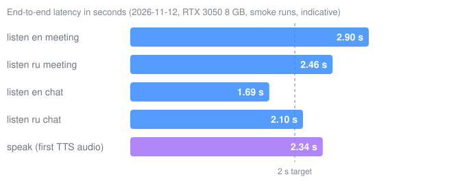

# tinglongWu

面向会议与通话的离线实时语音翻译。

[English](README.md) | [繁體中文](README.zh-TW.md) | 简体中文

<!-- TODO: screenshot or GIF of the subtitle window (docs/img/demo.gif); no screenshot exists in the repo yet. -->

## 安装

| 系统 | 命令 |
|---|---|
| Windows 10/11（64 位） | 下载 [tinglongwu-setup.exe](https://github.com/sunososobro-hub/tinglongwu/releases/latest/download/tinglongwu-setup.exe)，运行后勾选同意许可，再一直点 **Next** |
| macOS | `curl -fsSL https://github.com/sunososobro-hub/tinglongwu/releases/latest/download/mac_install.sh \| bash` |
| Linux（x86_64，已在 Ubuntu 24.04 测试） | `curl -fsSL https://github.com/sunososobro-hub/tinglongwu/releases/latest/download/install.sh \| bash` |

| 系统 | 安装 | 翻译字幕 | 说话（语音） | GPU | 纯 CPU |
|---|:-:|:-:|:-:|:-:|:-:|
| Windows 10/11 | 🟡 | 🟢 | ⚪ | 🟢 | 🟡 |
| macOS | 🟡 | ⚪ | ⚪ | ⚪ | ⚪ |
| Linux（Ubuntu 24.04） | 🟢 | 🟢 | 🟢 | ⚪ | 🟡 |

| 语言 | 听得懂 | 译成中文 | 译成英文 | 念出来（语音） |
|---|:-:|:-:|:-:|:-:|
| 中文 | 🟢 | — | 🟢 | 🟢 |
| 英文 | 🟢 | 🟢 | — | ⚪ |
| 日文 | 🟢 | 🟢 | ⚪ | ⚪ |
| 俄文 | 🟡 | 🟡 | ⚪ | 🟡 |
| 韩文 | ⚪ | ⚪ | ⚪ | ⚪ |

🟢 已在实机或发版关卡测试 · 🟡 仅在 CI 或评测测过，尚未上实机（Windows 安装：指安装向导；便携版 zip 已实机测试。纯 CPU：尚未在实体笔记本测延迟） · ⚪ 尚未测试或不支持 · — 同一语言

第一次安装？先看[安装时可能看到的画面](docs/install.md#what-you-might-see-during-install)（未签名警告是正常的，英文）。

感谢 4 位朋友一起打造：   

## 文档

**[文档（安装选项、系统要求、隐私、FAQ、全部指南）](https://sunososobro-hub.github.io/tinglongwu/docs.html)** · [完整旧版说明](docs/readme-full.zh-CN.md)

MIT License. See [LICENSE](LICENSE). (c) 2026 Alonso.
