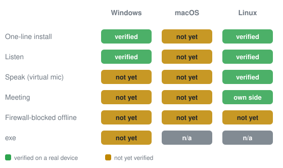
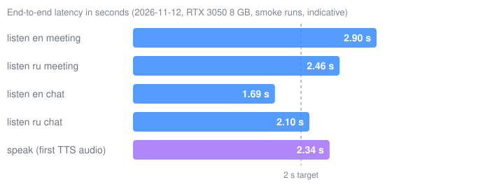
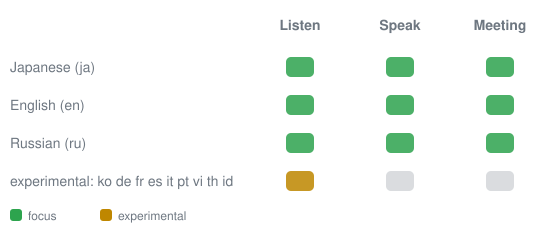

# tinglongWu

會議與通話用的離線即時語音翻譯。

[English](README.md) | 繁體中文 | [简体中文](README.zh-CN.md)

<!-- TODO: screenshot or GIF of the subtitle window (docs/img/demo.gif); no screenshot exists in the repo yet. -->

## 安裝

| 系統 | 指令 |
|---|---|
| Windows 64 位元 | 下載 [tinglongwu-win64.zip](https://github.com/sunososobro-hub/tinglongwu/releases/latest/download/tinglongwu-win64.zip)，解壓縮後雙擊 `tlwu.exe` |
| Linux（x86_64，已在 Ubuntu 24.04 測試） | `curl -fsSL https://github.com/sunososobro-hub/tinglongwu/releases/latest/download/install.sh \| bash` |
| macOS | `curl -fsSL https://github.com/sunososobro-hub/tinglongwu/releases/latest/download/mac_install.sh \| bash` |

## 驗證狀態

## 文件

**[文件（安裝選項、系統需求、隱私、FAQ、全部指南）](https://sunososobro-hub.github.io/tinglongwu/docs.html)** · [完整舊版說明](docs/readme-full.zh-TW.md)

MIT License. See [LICENSE](LICENSE). (c) 2026 Alonso.
