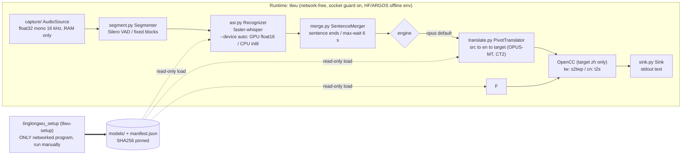

# Architecture

[English](ARCHITECTURE.md) | [繁體中文](ARCHITECTURE.zh-TW.md) | [简体中文](ARCHITECTURE.zh-CN.md) | [README](../README.md)

## 0. Install / use split

`tinglongwu_setup` (entry point `tlwu-setup`) is the only networked code: dependency install, model download + SHA256 pinning, `--bundle` / `--from-bundle` for air-gapped machines. The runtime `tlwu` has no download or network code; `tests/test_no_network_code.py` statically scans `tinglongwu/` and fails on imports of requests, urllib.request, http.client, httpx, urllib3, huggingface_hub, argostranslate, pip, tinglongwu_setup, or socket (except `tinglongwu/offline.py`, the guard), or http.client (except `tinglongwu/ollama.py`, the loopback-only client of the opt-in `--engine ollama`, #356). `tinglongwu_setup` never imports `tinglongwu`.

## 1. Data flow

Every box inside "Runtime" works without network. `tlwu-setup` is outside the runtime: it is a separate process, never imported by `tinglongwu`, run by hand once per model set. Audio exists only in RAM; the only output is stdout.

## 2. Components

| Tool / model | Role | Pin | License | Source | Implements | How to swap |
|---|---|---|---|---|---|---|
| soundcard | live loopback/mic capture | 0.4.6 | BSD-3 | github.com/bastibe/SoundCard | `tinglongwu/capture/_soundcard.py` `SoundcardSource` (subclassed by `wasapi.py` `WasapiLoopbackSource`, `pulse.py` `PulseMonitorSource`, `macos.py` `MacLoopbackSource`, `mic.py` `MicSource`) | Subclass `AudioSource` (`capture/base.py`, one method `frames()`), then add a branch in `select_backend()` in `capture/__init__.py` |
| soundfile + PyAV | file decode (wav/flac/ogg; mp3/m4a), in memory | 0.14.0 / 19.0.2 | BSD-3 / BSD-3 (+LGPL libs) | github.com/bastibe/python-soundfile, github.com/PyAV-Org/PyAV | `capture/file.py` `FileSource` | Same as above |
| scipy | resample to 16 kHz | 1.18.1 | BSD-3 | scipy.org | `capture/base.py` `to_mono_16k` | Edit that one function |
| Silero VAD (in faster-whisper) | pause splitting | via faster-whisper 1.2.1 | MIT | github.com/snakers4/silero-vad | `segment.py` `silero_vad` used by `Segmenter` | Pass any `vad_fn(audio) -> [(start, end)]` to `Segmenter(vad_fn=...)` (built in `cli.py main`) |
| faster-whisper + CTranslate2 | ASR | 1.2.1 / 4.8.5 | MIT / MIT | github.com/SYSTRAN/faster-whisper, github.com/OpenNMT/CTranslate2 | `asr.py` `FasterWhisperRecognizer` | Subclass `Recognizer` (`transcribe(audio) -> Transcript\|None`), instantiate it in `cli.py main` |
| Whisper weights (Systran CT2) | ASR model | HF sha pinned on first download (committed pins: `tinglongwu_setup/manifest.json`; local record: `models/manifest.json`) | MIT | huggingface.co/Systran/faster-whisper-* | loaded by `FasterWhisperRecognizer` | `--model`; new sizes: extend `choices` in `cli.py` and `tlwu-setup` |
| OPUS-MT (Argos packages) + SentencePiece | default translation, src->en->target | models: URL + SHA256 pinned; sentencepiece 0.2.3 | CC-BY 4.0 / Apache-2.0 | github.com/Helsinki-NLP/Opus-MT, github.com/argosopentech/argospm-index | `translate.py` `OpusStep` inside `PivotTranslator` | Pass `step_factory(src, tgt) -> callable(str) -> str` to `PivotTranslator`, or subclass `Translator` |
| CUDA 12 libs (cuBLAS, cuDNN 9) | optional GPU runtime | pip pins in `requirements-gpu.txt` | NVIDIA CUDA EULA (not redistributed by this repo) | pypi.org/project/nvidia-cublas-cu12 | `device.py` | `tlwu-setup --gpu`; `--device auto|cpu|cuda` |
| OpenCC (opencc-python-reimplemented) | zh script conversion | 0.1.7 | Apache-2.0 | github.com/yichen0831/opencc-python | `translate.py` `zh_convert` | Edit `zh_convert` (config names `s2twp`, `t2s`) |
| pymorphy3 + pymorphy3-dicts-ru (+ DAWG2-Python) | Russian name declension before MT (#390), lazy-loaded on the first Russian sentence, ~13 MB dictionary | 2.0.6 / 2.4.417150.4580142 / 0.9.0 | MIT / MIT / MIT | github.com/no-plagiarism/pymorphy3 | `lang/ru/__init__.py` `pre_mt` | Replace `pre_mt` in `tinglongwu/lang/ru/` |
| (stdout) | output | n/a | n/a | n/a | `sink.py` `TextSink`, `TranscriptSink`; `TTSSink` is a stub (no TTS in the main package; reverse-mode speech runs in a separate worker subprocess) | Subclass `Sink` (`write(Result)`), pick it in `cli.py main` |
| huggingface_hub | model download only | 2.4.0 | Apache-2.0 | github.com/huggingface/huggingface_hub | used only by `tinglongwu_setup (tlwu-setup)` (and internally by faster-whisper, offline) | n/a |
| psutil | connection monitor | 7.2.2 | BSD-3 | github.com/giampaolo/psutil | `scripts/verify_offline.py` | n/a |
| Reverse mode (optional): LLM + TTS + virtual cable | zh->ru/en/ja translation, fixed-voice speech, routing into meeting apps | see `requirements-llama-cuda.txt`, `tinglongwu_setup/manifest.json` | Qwen3 Apache-2.0, llama-cpp-python MIT, Hy-MT2 Apache-2.0, Vosk-TTS code Apache-2.0 (Russian voice model: no license stated upstream, unclear; optional and opt-in, only fetched by `tlwu-setup --vosk-tts-ru`, never by a default setup), kokoro-onnx MIT, Kokoro model Apache-2.0, espeak-ng GPL-3.0+ and phonemizer GPL-3.0 (both pulled in by kokoro-onnx; Kokoro venv only, not bundled in the repo or the exe), misaki Apache-2.0, BlackHole GPL-3.0, VB-CABLE donationware/proprietary; misaki[ja] extras MIT/Apache-2.0 | see the README license table (user installs BlackHole / VB-CABLE; not bundled) | `tinglongwu/reverse/` (`tts_worker.py` runs Vosk-TTS or Kokoro, built-in fixed voices only, no voice cloning) | `--tts-engine vosk|kokoro`; add an engine as a branch in `tts_worker.py` + `tts_client.py` |

**Per-language patches (#390).** Language-specific behaviour lives in `tinglongwu/lang/<code>/` (today `ja`, `ru`, `zh`), never as `if lang == "xx"` branches in core modules. Core code asks `tinglongwu.lang.setting(lang, NAME, default)` with a language-neutral default; the names are listed in `tinglongwu/lang/__init__.py`. Two of them are text hooks around MT, both called from `translate.translate_checked` (the one funnel for finished lines and drafts): `pre_mt(text)` from the **source** language's package rewrites the sentence before it reaches any engine (the shown/saved source line is unchanged), and `post_mt(text, src)` from the **target** language's package rewrites the output. First patch: `lang/ru` `pre_mt` puts declined person names into the nominative of the person's gender ("Максима Чижова" -> "Максим Чижов", so Hy-MT2 writes 奇若夫, not 奇佐娃). To add a language: create `tinglongwu/lang/<code>/__init__.py`, define the names it needs, and add it to `PATCHES`.

There is no plugin registry: the pipeline is assembled explicitly in `tinglongwu/cli.py main()`, so "registering" a component means constructing it there (and adding a CLI choice if users should select it).

## 3. How we prove no data leaves

Four independent layers; each covers a failure of the others.

1. **In-process socket guard** (`tinglongwu/offline.py`): on `import tinglongwu`, `socket.connect`, `connect_ex`, `getaddrinfo`, `gethostbyname` are patched to raise `NetworkBlocked` for any non-loopback target. Always on. Tested in `tests/test_offline.py`. Limit: only protects Python-level sockets in this process (a native extension opening its own socket bypasses it).
2. **Offline env flags** (same file, set before any HF/ctranslate2 import): `HF_HUB_OFFLINE=1`, `TRANSFORMERS_OFFLINE=1`, `HF_HUB_DISABLE_TELEMETRY=1`, `DO_NOT_TRACK=1`, `ARGOS_*`. Models load only from the local `models/` directory; missing models raise an error instead of downloading.
3. **Process-tree connection monitor** (`scripts/verify_offline.py`): runs tinglongWu (or attaches to a PID) and polls the whole process tree with psutil every 50 ms; exit code 1 on any non-loopback connection. Limit: polling can miss a very short connection.
4. **OS-level block** (README "Firewall block test"): Windows `New-NetFirewallRule`, Linux `unshare -n` / nftables, macOS `pf` / Little Snitch / LuLu. tlwu must keep working with the network physically denied. This is the layer that does not trust our code.

Supply chain: dependencies are pinned with `==` (`pyproject.toml`, full lock in `requirements.txt`). Audit them periodically with `pip-audit -r requirements.txt` (run on a networked machine; it queries vulnerability databases) and review the dependency list in the README license table. Model files are SHA256-pinned in `models/manifest.json` and re-verified with `python tinglongwu_setup (tlwu-setup) --verify` (offline).
