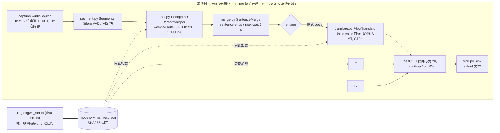

# 架构

[English](ARCHITECTURE.md) | [繁體中文](ARCHITECTURE.zh-TW.md) | [简体中文](ARCHITECTURE.zh-CN.md) | [README](../README.zh-CN.md)

## 0. 安装／使用分离

`tinglongwu_setup`（入口 `tlwu-setup`）是唯一的联网代码：安装依赖、下载模型并用 SHA256 固定、`--bundle`／`--from-bundle` 供隔离网络的电脑使用。运行时 `tlwu` 没有任何下载或网络代码；`tests/test_no_network_code.py` 会静态扫描 `tinglongwu/`，若导入 requests、urllib.request、http.client、httpx、urllib3、huggingface_hub、argostranslate、pip、tinglongwu_setup 或 socket（防护模块 `tinglongwu/offline.py` 除外）即失败。`tinglongwu_setup` 不会导入 `tlwu`。

## 1. 数据流

“运行时”内的每个方框都不需要网络。`tlwu-setup` 位于运行时之外：它是独立进程，`tlwu` 不会导入它，由人手动运行（每组模型一次）。音频只在内存，唯一输出是 stdout。

## 2. 组件

| 工具／模型 | 角色 | 版本固定 | 许可证 | 来源 | 实现位置 | 如何替换 |
|---|---|---|---|---|---|---|
| soundcard | 实时回环／麦克风采集 | 0.4.6 | BSD-3 | github.com/bastibe/SoundCard | `tinglongwu/capture/_soundcard.py` `SoundcardSource`（由 `wasapi.py` `WasapiLoopbackSource`、`pulse.py` `PulseMonitorSource`、`macos.py` `MacLoopbackSource`、`mic.py` `MicSource` 继承） | 继承 `AudioSource`（`capture/base.py`，单一方法 `frames()`），再到 `capture/__init__.py` 的 `select_backend()` 加分支 |
| soundfile + PyAV | 文件解码（wav/flac/ogg；mp3/m4a），内存中 | 0.14.0 / 19.0.2 | BSD-3 / BSD-3（含 LGPL 库） | github.com/bastibe/python-soundfile、github.com/PyAV-Org/PyAV | `capture/file.py` `FileSource` | 同上 |
| scipy | 重采样到 16 kHz | 1.18.1 | BSD-3 | scipy.org | `capture/base.py` `to_mono_16k` | 修改该函数 |
| Silero VAD（内置于 faster-whisper） | 停顿切分 | 随 faster-whisper 1.2.1 | MIT | github.com/snakers4/silero-vad | `segment.py` `silero_vad`，由 `Segmenter` 使用 | 把任意 `vad_fn(audio) -> [(start, end)]` 传给 `Segmenter(vad_fn=...)`（在 `cli.py main` 构建） |
| faster-whisper + CTranslate2 | 语音识别 | 1.2.1 / 4.8.5 | MIT / MIT | github.com/SYSTRAN/faster-whisper、github.com/OpenNMT/CTranslate2 | `asr.py` `FasterWhisperRecognizer` | 继承 `Recognizer`（`transcribe(audio) -> Transcript\|None`），在 `cli.py main` 实例化 |
| Whisper 权重（Systran CT2） | ASR 模型 | 首次下载时将 HF sha 固定到 `models/manifest.json` | MIT | huggingface.co/Systran/faster-whisper-* | 由 `FasterWhisperRecognizer` 加载 | `--model`；新增尺寸需扩展 `cli.py` 和 `tlwu-setup` 的 `choices` |
| OPUS-MT（Argos 包）+ SentencePiece | 默认翻译，源->en->目标 | 模型：URL + SHA256 固定；sentencepiece 0.2.3 | CC-BY 4.0 / Apache-2.0 | github.com/Helsinki-NLP/Opus-MT、github.com/argosopentech/argospm-index | `translate.py` `PivotTranslator` 内的 `OpusStep` | 给 `PivotTranslator` 传入 `step_factory(src, tgt) -> callable(str) -> str`，或继承 `Translator` |
| M2M-100（CT2，由 tlwu-setup 转换） | 可选直接翻译 | HF sha 与转换后权重 SHA256 均固定 | MIT | huggingface.co/facebook/m2m100_1.2B | `translate.py` `M2mTranslator` | `--engine m2m`；转换需仅用于开发的 torch+transformers（`TLWU_CONVERTER_PYTHON`） |
| CUDA 12 库（cuBLAS、cuDNN 9） | 可选 GPU 运行时 | `requirements-gpu.txt` 固定版本 | NVIDIA CUDA EULA（本 repo 不分发） | pypi.org/project/nvidia-cublas-cu12 | `device.py` | `tlwu-setup --gpu`；`--device auto|cpu|cuda` |
| OpenCC（opencc-python-reimplemented） | 中文字形转换 | 0.1.7 | Apache-2.0 | github.com/yichen0831/opencc-python | `translate.py` `zh_convert` | 修改 `zh_convert`（配置名 `s2twp`、`t2s`） |
| （stdout） | 输出 | 无 | 无 | 无 | `sink.py` `TextSink`、`TranscriptSink`；`TTSSink` 为桩（主包不含 TTS；反向模式的语音在独立 worker 子进程中运行） | 继承 `Sink`（`write(Result)`），在 `cli.py main` 选用 |
| huggingface_hub | 仅用于下载模型 | 2.4.0 | Apache-2.0 | github.com/huggingface/huggingface_hub | 仅 `tinglongwu_setup (tlwu-setup)` 使用（faster-whisper 内部也引用，离线） | 无 |
| psutil | 连接监控 | 7.2.2 | BSD-3 | github.com/giampaolo/psutil | `scripts/verify_offline.py` | 无 |
| 反向模式（可选）：LLM＋TTS＋虚拟音频线 | zh->ru/en/ja 翻译、固定语音合成、导入会议软件 | 见 `requirements-qwen.txt`、`tinglongwu_setup/manifest.json` | Qwen3 Apache-2.0、llama-cpp-python MIT、Hy-MT2 Apache-2.0、Vosk-TTS 代码 Apache-2.0（俄语语音模型：上游未标示许可，不明；可选、需主动启用，只由 `tlwu-setup --vosk-tts-ru` 获取，默认安装绝不下载）、kokoro-onnx MIT、Kokoro 模型 Apache-2.0、espeak-ng GPL-3.0+ 与 phonemizer GPL-3.0（均由 kokoro-onnx 带入；仅 Kokoro 独立 venv，repo 与 exe 均不内置）、misaki Apache-2.0、BlackHole GPL-3.0、VB-CABLE 捐赠制／专有；misaki[ja] 附带包 MIT／Apache-2.0 | 见 README 许可证表（BlackHole／VB-CABLE 由用户自行安装，不内置） | `tinglongwu/reverse/`（`tts_worker.py` 运行 Vosk-TTS 或 Kokoro，仅内置固定语音，无声音克隆） | `--tts-engine vosk|kokoro`；新增引擎＝在 `tts_worker.py` 与 `tts_client.py` 加分支 |

没有插件注册表：管线在 `tinglongwu/cli.py main()` 中显式组装，所谓“注册”就是在那里构造组件（若要让用户选择，再加 CLI choice）。

## 3. 如何证明数据不外泄

四层相互独立，各自弥补其他层的失效。

1. **进程内 socket 防护**（`tinglongwu/offline.py`）：`import tinglongwu` 时，把 `socket.connect`、`connect_ex`、`getaddrinfo`、`gethostbyname` 改为对任何非 loopback 目标抛出 `NetworkBlocked`。始终开启，测试见 `tests/test_offline.py`。局限：只保护本进程的 Python 层 socket（原生扩展自行创建 socket 可绕过）。
2. **离线环境变量**（同文件，在任何 HF/ctranslate2 导入前设置）：`HF_HUB_OFFLINE=1`、`TRANSFORMERS_OFFLINE=1`、`HF_HUB_DISABLE_TELEMETRY=1`、`DO_NOT_TRACK=1`、`ARGOS_*`。模型只从本地 `models/` 加载；缺少模型会报错而不是下载。
3. **进程树连接监控**（`scripts/verify_offline.py`）：运行 tlwu（或附加到 PID），每 50 ms 用 psutil 轮询整个进程树；出现任何非 loopback 连接即以代码 1 退出。局限：轮询可能漏掉极短的连接。
4. **操作系统层封锁**（README“防火墙封锁测试”）：Windows `New-NetFirewallRule`、Linux `unshare -n`／nftables、macOS `pf`／Little Snitch／LuLu。网络被实际封死时 tlwu 必须照常工作。这一层不信任我们的代码。

供应链：依赖以 `==` 固定版本（`pyproject.toml`，完整锁定在 `requirements.txt`）。请定期在有网络的机器上运行 `pip-audit -r requirements.txt`（会查询漏洞数据库），并查看 README 许可证表中的依赖清单。模型文件以 SHA256 固定在 `models/manifest.json`，可用 `python tinglongwu_setup (tlwu-setup) --verify`（离线）重新校验。
