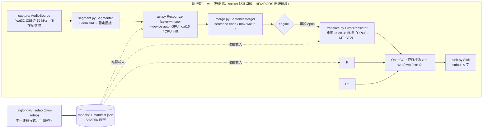

# 架構

[English](ARCHITECTURE.md) | [繁體中文](ARCHITECTURE.zh-TW.md) | [简体中文](ARCHITECTURE.zh-CN.md) | [README](../README.zh-TW.md)

## 0. 安裝／使用分離

`tinglongwu_setup`（進入點 `tlwu-setup`）是唯一的連網程式碼：安裝相依、下載模型並以 SHA256 釘選、`--bundle`／`--from-bundle` 供隔離網路電腦使用。執行期 `tlwu` 沒有任何下載或網路程式碼；`tests/test_no_network_code.py` 會靜態掃描 `tinglongwu/`，若匯入 requests、urllib.request、http.client、httpx、urllib3、huggingface_hub、argostranslate、pip、tinglongwu_setup 或 socket（防護模組 `tinglongwu/offline.py` 除外）即失敗。`tinglongwu_setup` 不會匯入 `tlwu`。

## 1. 資料流

「執行期」內的每個方塊都不需要網路。`tlwu-setup` 位於執行期之外：它是獨立行程，`tlwu` 不會匯入它，由人手動執行（每組模型一次）。音訊只在記憶體，唯一輸出是 stdout。

## 2. 元件

| 工具／模型 | 角色 | 版本釘選 | 授權 | 來源 | 實作位置 | 如何替換 |
|---|---|---|---|---|---|---|
| soundcard | 即時回放／麥克風擷取 | 0.4.6 | BSD-3 | github.com/bastibe/SoundCard | `tinglongwu/capture/_soundcard.py` `SoundcardSource`（由 `wasapi.py` `WasapiLoopbackSource`、`pulse.py` `PulseMonitorSource`、`macos.py` `MacLoopbackSource`、`mic.py` `MicSource` 繼承） | 繼承 `AudioSource`（`capture/base.py`，單一方法 `frames()`），再到 `capture/__init__.py` 的 `select_backend()` 加分支 |
| soundfile + PyAV | 檔案解碼（wav/flac/ogg；mp3/m4a），記憶體內 | 0.14.0 / 19.0.2 | BSD-3 / BSD-3（含 LGPL 函式庫） | github.com/bastibe/python-soundfile、github.com/PyAV-Org/PyAV | `capture/file.py` `FileSource` | 同上 |
| scipy | 重取樣至 16 kHz | 1.18.1 | BSD-3 | scipy.org | `capture/base.py` `to_mono_16k` | 修改該函式 |
| Silero VAD（內含於 faster-whisper） | 停頓切段 | 隨 faster-whisper 1.2.1 | MIT | github.com/snakers4/silero-vad | `segment.py` `silero_vad`，由 `Segmenter` 使用 | 將任何 `vad_fn(audio) -> [(start, end)]` 傳入 `Segmenter(vad_fn=...)`（在 `cli.py main` 建立） |
| faster-whisper + CTranslate2 | 語音辨識 | 1.2.1 / 4.8.5 | MIT / MIT | github.com/SYSTRAN/faster-whisper、github.com/OpenNMT/CTranslate2 | `asr.py` `FasterWhisperRecognizer` | 繼承 `Recognizer`（`transcribe(audio) -> Transcript\|None`），在 `cli.py main` 實例化 |
| Whisper 權重（Systran CT2） | ASR 模型 | 首次下載時將 HF sha 釘於 `models/manifest.json` | MIT | huggingface.co/Systran/faster-whisper-* | 由 `FasterWhisperRecognizer` 載入 | `--model`；新增尺寸需擴充 `cli.py` 與 `tlwu-setup` 的 `choices` |
| OPUS-MT（Argos 套件）+ SentencePiece | 預設翻譯，來源->en->目標 | 模型：URL + SHA256 釘選；sentencepiece 0.2.3 | CC-BY 4.0 / Apache-2.0 | github.com/Helsinki-NLP/Opus-MT、github.com/argosopentech/argospm-index | `translate.py` `PivotTranslator` 內的 `OpusStep` | 傳入 `step_factory(src, tgt) -> callable(str) -> str` 給 `PivotTranslator`，或繼承 `Translator` |
| M2M-100（CT2，由 tlwu-setup 轉換） | 選用直接翻譯 | HF sha 與轉換後權重 SHA256 皆釘住 | MIT | huggingface.co/facebook/m2m100_1.2B | `translate.py` `M2mTranslator` | `--engine m2m`；轉換需僅限開發用的 torch+transformers（`TLWU_CONVERTER_PYTHON`） |
| CUDA 12 函式庫（cuBLAS、cuDNN 9） | 選用 GPU 執行期 | `requirements-gpu.txt` 釘版 | NVIDIA CUDA EULA（本 repo 不散布） | pypi.org/project/nvidia-cublas-cu12 | `device.py` | `tlwu-setup --gpu`；`--device auto|cpu|cuda` |
| OpenCC（opencc-python-reimplemented） | 中文字形轉換 | 0.1.7 | Apache-2.0 | github.com/yichen0831/opencc-python | `translate.py` `zh_convert` | 修改 `zh_convert`（設定名 `s2twp`、`t2s`） |
| （stdout） | 輸出 | 無 | 無 | 無 | `sink.py` `TextSink`、`TranscriptSink`；`TTSSink` 為樁（主套件不含 TTS；反向模式的語音在獨立 worker 子行程中執行） | 繼承 `Sink`（`write(Result)`），在 `cli.py main` 選用 |
| huggingface_hub | 僅用於下載模型 | 2.4.0 | Apache-2.0 | github.com/huggingface/huggingface_hub | 僅 `tinglongwu_setup (tlwu-setup)` 使用（faster-whisper 內部亦引用，離線） | 無 |
| psutil | 連線監控 | 7.2.2 | BSD-3 | github.com/giampaolo/psutil | `scripts/verify_offline.py` | 無 |
| 反向模式（選用）：LLM＋TTS＋虛擬音訊線 | zh->ru/en/ja 翻譯、固定語音合成、導入會議軟體 | 見 `requirements-qwen.txt`、`tinglongwu_setup/manifest.json` | Qwen3 Apache-2.0、llama-cpp-python MIT、Hy-MT2 Apache-2.0、Vosk-TTS 程式碼 Apache-2.0（俄語語音模型：上游未標示授權，不明；選用、需主動啟用，只由 `tlwu-setup --vosk-tts-ru` 取得，預設安裝絕不下載）、kokoro-onnx MIT、Kokoro 模型 Apache-2.0、espeak-ng GPL-3.0+ 與 phonemizer GPL-3.0（皆由 kokoro-onnx 帶入；僅 Kokoro 獨立 venv，repo 與 exe 皆不內建）、misaki Apache-2.0、BlackHole GPL-3.0、VB-CABLE 捐贈制／專有；misaki[ja] 附帶套件 MIT／Apache-2.0 | 見 README 授權表（BlackHole／VB-CABLE 由使用者自行安裝，不內建） | `tinglongwu/reverse/`（`tts_worker.py` 執行 Vosk-TTS 或 Kokoro，僅內建固定語音，無聲音複製） | `--tts-engine vosk|kokoro`；新增引擎＝在 `tts_worker.py` 與 `tts_client.py` 加分支 |

沒有外掛註冊表：管線在 `tinglongwu/cli.py main()` 明確組裝，所謂「註冊」就是在那裡建構元件（若要讓使用者選擇，再加 CLI choice）。

## 3. 如何證明資料不外流

四層彼此獨立，各自補足其他層的失效。

1. **行程內 socket 防護**（`tinglongwu/offline.py`）：`import tinglongwu` 時，將 `socket.connect`、`connect_ex`、`getaddrinfo`、`gethostbyname` 改為對任何非 loopback 目標丟出 `NetworkBlocked`。永遠開啟，測試見 `tests/test_offline.py`。限制：只保護本行程的 Python 層 socket（原生擴充自行開 socket 可繞過）。
2. **離線環境變數**（同檔，於任何 HF/ctranslate2 匯入前設定）：`HF_HUB_OFFLINE=1`、`TRANSFORMERS_OFFLINE=1`、`HF_HUB_DISABLE_TELEMETRY=1`、`DO_NOT_TRACK=1`、`ARGOS_*`。模型只從本機 `models/` 載入；缺模型會報錯而非下載。
3. **行程樹連線監控**（`scripts/verify_offline.py`）：執行 tlwu（或附加到 PID），每 50 ms 以 psutil 輪詢整個行程樹；出現任何非 loopback 連線即以代碼 1 結束。限制：輪詢可能漏掉極短的連線。
4. **作業系統層封鎖**（README「防火牆封鎖測試」）：Windows `New-NetFirewallRule`、Linux `unshare -n`／nftables、macOS `pf`／Little Snitch／LuLu。網路被實際封死時 tlwu 必須照常運作。這一層不信任我們的程式碼。

供應鏈：相依套件以 `==` 釘版（`pyproject.toml`，完整鎖定在 `requirements.txt`）。請定期在有網路的機器上執行 `pip-audit -r requirements.txt`（會查詢漏洞資料庫），並檢視 README 授權表的相依清單。模型檔以 SHA256 釘於 `models/manifest.json`，可用 `python tinglongwu_setup (tlwu-setup) --verify`（離線）重新驗證。
