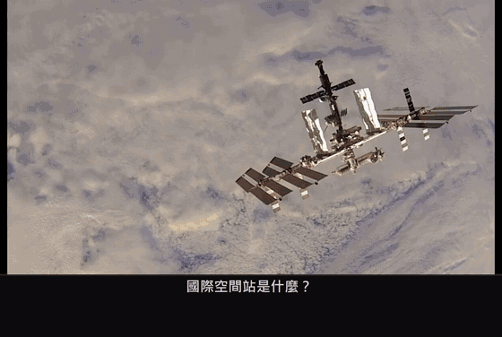
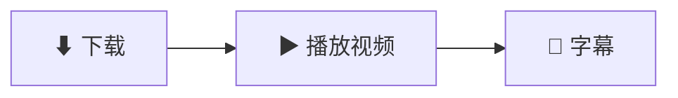
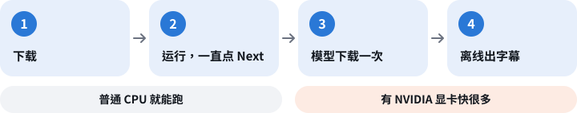

[English](../README.md) | [繁體中文](README.zh-TW.md) | 简体中文

# tinglongWu 听龙

 77 MB + 1.6 GB 模型 · SmartScreen：更多信息 → 仍要运行

更多：安装、隐私、常见问题、参与

  

## 下载

| | 安装 |
|---|---|
| **Windows 10/11** | **[⬇ 下载 tinglongwu-setup.exe](https://github.com/sunososobro-hub/tinglongwu/releases/latest/download/tinglongwu-setup.exe)**，运行后一直点 **Next** |
| macOS | `curl -fsSL https://github.com/sunososobro-hub/tinglongwu/releases/latest/download/mac_install.sh \| bash` |
| Linux (x86_64) | `curl -fsSL https://github.com/sunososobro-hub/tinglongwu/releases/latest/download/install.sh \| bash` |

Windows 会显示 SmartScreen 警告（安装程序尚未签名，#601 完成前如此）：Edge 会先说“不常下载”且没有“保留”按钮：鼠标移到下载项 → … → 保留 → 点“删除”旁的 ▾ → 仍要保留；之后在 SmartScreen 画面点“更多信息 → 仍要运行”。想先检查？到[发布页](https://github.com/sunososobro-hub/tinglongwu/releases/latest)下载 `mac_install.sh` / `install.sh`，读过并与该页的 `SHA256SUMS.txt` 比对后再运行。

安装时会下载一次语音识别和翻译模型（需要网络），之后翻译、音频和字幕完全离线，从不联网。自动更新（默认开启）每天检查一次 GitHub，不发送任何 ID；安装时取消勾选或设置 `TLWU_OFFLINE=1` 即完全不联网。

## 语言与电脑需求

更多语言陆续加入（[语言计划](VISION.md)）。[完整文档：需求、隐私、常见问题](https://sunososobro-hub.github.io/tinglongwu/docs.html) · [平台支持](support.md)

## 想帮忙？

- 📘 [怎么参与](../.github/CONTRIBUTING.md)：欢迎提 PR，默认答案是 yes
- 🟢 [新手友好的题目](https://github.com/sunososobro-hub/tinglongwu/labels/good%20first%20issue)
- 🐞 [用你自己的 AI 报告问题](report-with-ai.zh-TW.md)：不用 GitHub 账号，复制一段提示贴给 ChatGPT / Claude / Gemini（繁体页面）
- 💬 [讨论区](https://github.com/sunososobro-hub/tinglongwu/discussions)：提问题、分享你怎么用、提点子（不用会写代码）
- 🧭 [愿景：我们做什么、绝不做什么](VISION.md)
- 🗺️ [路线图](https://sunososobro-hub.github.io/tinglongwu/roadmap.html) · 📍 [下一版进度](https://github.com/sunososobro-hub/tinglongwu/milestones) · 📊 [项目活跃度](https://sunososobro-hub.github.io/tinglongwu/)

<!-- CONTRIBUTORS:START -->
<b>感谢 7 位朋友一起打造</b>

      

<a href="details.md#contributors">图示说明与 AI 帮手</a>
<!-- CONTRIBUTORS:END -->

MIT 授权，见 [LICENSE](../LICENSE)。(c) 2026 Alonso.

 听龙 / TingLong，专心听的龙

