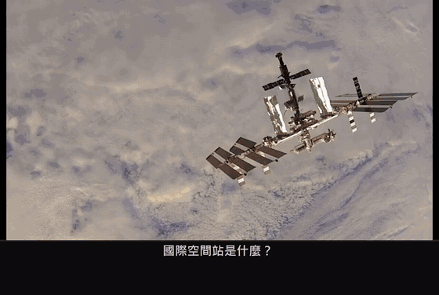
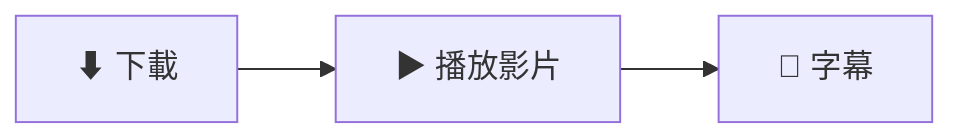
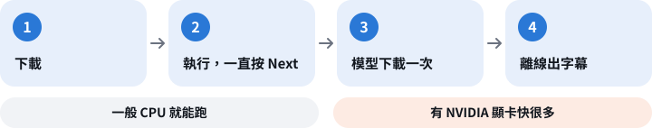

[English](../README.md) | 繁體中文 | [简体中文](README.zh-CN.md)

# tinglongWu 聽龍

 77 MB + 1.6 GB 模型 · SmartScreen：其他資訊 → 仍要執行

更多：安裝、隱私、常見問題、參與

  

## 下載

| | 安裝 |
|---|---|
| **Windows 10/11** | **[⬇ 下載 tinglongwu-setup.exe](https://github.com/sunososobro-hub/tinglongwu/releases/latest/download/tinglongwu-setup.exe)**，執行後一直按 **Next** |
| macOS | `curl -fsSL https://github.com/sunososobro-hub/tinglongwu/releases/latest/download/mac_install.sh \| bash` |
| Linux (x86_64) | `curl -fsSL https://github.com/sunososobro-hub/tinglongwu/releases/latest/download/install.sh \| bash` |

Windows 會顯示 SmartScreen 警告（安裝程式尚未簽章，#601 完成前如此）：Edge 會先說「不常下載」且沒有「保留」按鈕：滑到檔案上 → … → 保留 → 點「刪除」旁的 ▾ → 仍要保留；之後在 SmartScreen 畫面點「其他資訊 → 仍要執行」。想先檢查？到[發行頁](https://github.com/sunososobro-hub/tinglongwu/releases/latest)下載 `mac_install.sh` / `install.sh`，讀過並與該頁的 `SHA256SUMS.txt` 比對後再執行。

安裝時會下載一次語音辨識和翻譯模型（需要網路），之後翻譯、音訊和字幕完全離線，從不連網。自動更新（預設開啟）每天檢查一次 GitHub，不傳送任何 ID；安裝時取消勾選或設定 `TLWU_OFFLINE=1` 即完全不連網。

## 語言與電腦需求

更多語言陸續加入（[語言計畫](VISION.md)）。[完整文件：需求、隱私、常見問題](https://sunososobro-hub.github.io/tinglongwu/docs.html) · [平台支援](support.md)

## 想幫忙？

- 📘 [怎麼參與](../.github/CONTRIBUTING.md)：歡迎發 PR，預設答案是 yes
- 🟢 [新手友善的題目](https://github.com/sunososobro-hub/tinglongwu/labels/good%20first%20issue)
- 🐞 [用你自己的 AI 回報問題](report-with-ai.zh-TW.md)：不用 GitHub 帳號，複製一段提示貼給 ChatGPT / Claude / Gemini
- 💬 [討論區](https://github.com/sunososobro-hub/tinglongwu/discussions)：問問題、分享你怎麼用、提點子（不用會寫程式）
- 🧭 [願景：我們做什麼、絕不做什麼](VISION.md)
- 🗺️ [路線圖](https://sunososobro-hub.github.io/tinglongwu/roadmap.html) · 📍 [下一版進度](https://github.com/sunososobro-hub/tinglongwu/milestones) · 📊 [專案活躍度](https://sunososobro-hub.github.io/tinglongwu/)

<!-- CONTRIBUTORS:START -->
<b>感謝 7 位朋友一起打造</b>

      

<a href="details.md#contributors">圖示說明與 AI 幫手</a>
<!-- CONTRIBUTORS:END -->

MIT 授權，見 [LICENSE](../LICENSE)。[程式碼簽章政策](CODE_SIGNING_POLICY.md)（SignPath Foundation）。(c) 2026 Alonso.

 聽龍 / TingLong，專心聽的龍

