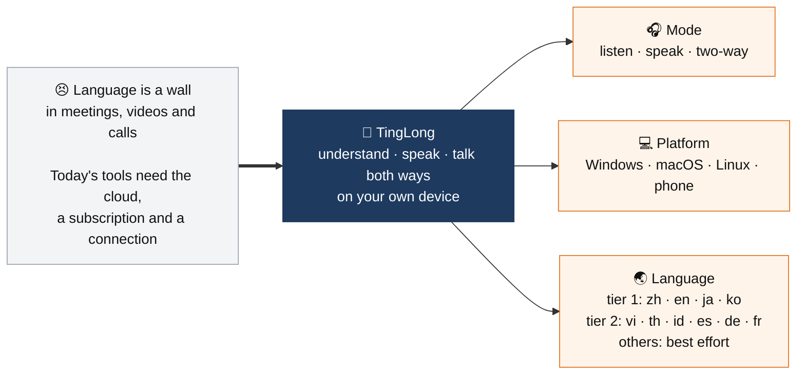

# Vision

> **Your own computer translates. Your voice never leaves it.**

The share of work each mode, platform and language gets follows market trends. The current focus lives on the throttle issue (#574), so this page does not change when the focus does.

## ✅ Principles

| | |
|---|---|
| 🔒 | **Fully offline.** Audio and text stay on the device. |
| 🗑️ | **No recordings kept.** Voiceprints only with each person's consent. |
| 🙂 | **Easy for users, smooth for contributors.** What we ship is plain to anyone; how we work is clear to developers. |
| 🟢 | **Green means tested.** A light turns green only after a real run. |
| 🆓 | **The core stays free and open source.** Paid add-ons, if any, live elsewhere. |

## ⛔ We don't

AI review checks every PR against this list and blocks a PR that crosses it.

| | |
|---|---|
| ☁️ | Send audio or text to a cloud service |
| 🧬 | Remember a voiceprint without consent |
| 📡 | Send usage data home |

Anything that stays inside these lines is welcome. See [CONTRIBUTING.md](../CONTRIBUTING.md) and the [roadmap](https://sunososobro-hub.github.io/tinglongwu/roadmap.html).
