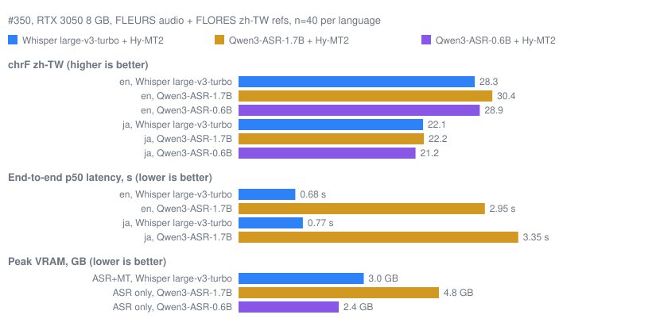

# Research: Qwen3-ASR vs Whisper + Hy-MT2 (#350)

Community question: why does tinglongWu use Whisper for speech recognition plus Hy-MT2 for translation, instead of an end-to-end model such as Qwen3-ASR?

**Result: no change. The default stays Whisper large-v3-turbo + Hy-MT2.**

## What Qwen3-ASR is

- License Apache-2.0 (offline use and redistribution allowed), sizes 1.7B and 0.6B, 30 languages including en, ja, ru and zh.
- It is speech recognition only. It has no translation mode, so it cannot replace the pipeline end to end: Hy-MT2 is still needed after it.
- It needs a separate multi-GB PyTorch runtime. There is no GGUF, CTranslate2 or ONNX build, and no faster runtime on Windows.

## Measured (owner PC, RTX 3050 8 GB)

Setup: FLEURS en/ja audio with FLORES zh-TW references, n=40 per language, scored with the repo scoring code. The translation model is Hy-MT2 1.8B in every row, so only the ASR stage differs. Qwen3-ASR ran with transformers in bf16, batch 1, on Windows.

| ASR (MT = Hy-MT2 1.8B) | chrF en | chrF ja | p50 / p90 en | p50 / p90 ja | Peak VRAM |
|---|---|---|---|---|---|
| Whisper large-v3-turbo (current) | 28.3 | 22.1 | 0.68 / 0.91 s | 0.77 / 1.09 s | about 3.0 GB (ASR+MT) |
| Qwen3-ASR-1.7B | 30.4 (+2.1) | 22.2 (+0.1) | 2.95 / 3.99 s | 3.35 / 6.15 s | 4.8 GB ASR alone, about 6.5-7 GB with Hy-MT2 |
| Qwen3-ASR-0.6B | 28.9 (+0.6) | 21.2 (-0.9) | not measured | not measured | 2.4 GB ASR alone |

## Decision

The adoption bar was: chrF at least +1.0 better, and within the current latency and VRAM budgets on the target tiers.

- chrF: only en with the 1.7B model clears +1.0. ja is +0.1 (1.7B) and -0.9 (0.6B).
- Latency: the 1.7B model is about 4x slower at p50 (3-6 s instead of under 1.1 s at p90).
- VRAM: the 1.7B model with Hy-MT2 needs about 6.5-7 GB, more than double today, and leaves little room on an 8 GB card.

So it fails the bar on ja chrF, latency and VRAM. Out of scope here and unchanged: the default engine, shipping the model, and the streaming protocol.

## Not covered

ru, the CPU tier and other GPU tiers were not measured, and n=40 per language is indicative only. The full run notes and commands are in the owner's local report (tlwu_reports/qwen3asr_350_20261113.md); the numbers above are copied from the result posted on #350. Revisit if Qwen3-ASR gets a CTranslate2/GGUF/ONNX build or a translation mode.
